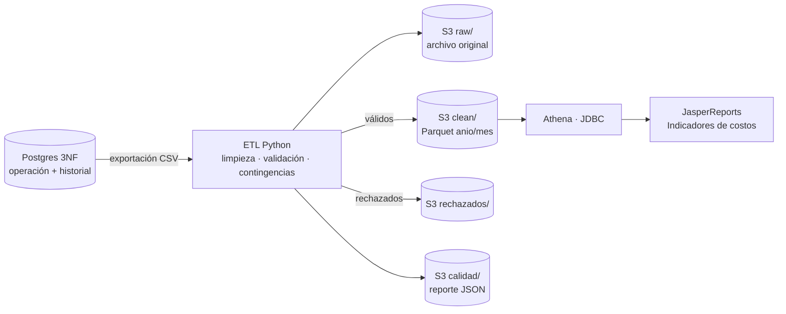

# Prueba técnica · Analista de Desarrollo y Gobierno de Datos

**Roldán Logistics** · Anderson Duvan Cortés González

[](https://github.com/AnderDev0/roldan-prueba-datos/actions/workflows/ci.yml)

Solución completa de la prueba. Cada fase tiene su carpeta con el código, cómo correrlo y la evidencia de que funciona. Las respuestas escritas están en [`docs/respuestas_prueba.pdf`](docs/respuestas_prueba.pdf).

## Resumen

| Fase | Qué hay | Evidencia |
|---|---|---|
| **1. Modelo y calidad** | Modelo 3NF en Postgres, carga del CSV con cuarentena de rechazados, cambio de estado + trazabilidad en una transacción | [`salida_prueba_acid.txt`](fase1_modelo/salida_prueba_acid.txt) · CI |
| **2. ETL Python + AWS** | Limpieza, validación, puntaje de calidad 0-100 por registro y carga a S3 en Parquet particionado | [`salida_carga_s3.txt`](fase2_etl/salida_carga_s3.txt) · [capturas de S3](fase2_etl/evidencias) |
| **2. Optimización SQL** | Prueba con 3 millones de eventos: índice compuesto, BRIN y partición por mes | [`salida_optimizacion.txt`](fase2_optimizacion_sql/salida_optimizacion.txt) |
| **3. Jasper** | Plantilla JRXML con grupos, `$V{TOTAL_COSTO}`, promedio de peso y `$P{EstadoFiltro}` | [PDF ambos estados](fase3_jasper/reporte_en_transito_y_aduana.pdf) · [PDF solo aduana](fase3_jasper/reporte_solo_aduana.pdf) |
| **4. Git y Scrum** | GitFlow aplicado en este mismo repo. El hotfix de Tumaco entró por [PR #1](https://github.com/AnderDev0/roldan-prueba-datos/pull/1) con CI | Historial de ramas y tags |

## Arquitectura



Postgres guarda la operación del día a día (consistencia, ACID). S3 + Parquet es la capa de análisis: barata, columnar y particionada para que Athena lea solo lo que necesita.

## Cómo correrlo

Requisitos: Python 3.11+ (probado en 3.13 y 3.14). Para la Fase 1, PostgreSQL 12+ con `psql`. AWS es opcional.

```bash
git clone https://github.com/AnderDev0/roldan-prueba-datos.git
cd roldan-prueba-datos
python -m venv .venv
source .venv/bin/activate            # en Windows (Git Bash): source .venv/Scripts/activate
pip install -r requirements.txt -r requirements-dev.txt

pytest                               # 11 pruebas
python fase2_etl/etl_operaciones.py --input data/raw/operaciones_logisticas.csv
```

La salida queda en `fase2_etl/salida/`. Para subirla a S3 se agrega `--bucket <bucket> --perfil <perfil-aws>`. El usuario IAM solo necesita la política de [`fase2_etl/aws/politica_iam_etl.json`](fase2_etl/aws/politica_iam_etl.json) (listar, leer y escribir en ese bucket). Las credenciales nunca van en el código.

**Modelo en Postgres:**

```bash
createdb roldan
psql -d roldan -f fase1_modelo/01_ddl.sql
psql -d roldan -f fase1_modelo/02_catalogos.sql
psql -d roldan -f fase1_modelo/03_carga_desde_csv.sql
psql -d roldan -f fase1_modelo/04_acid_cambio_estado.sql
```

`\copy` y `\echo` son comandos de `psql`. En pgAdmin se corren desde *PSQL Tool*, no desde el editor de consultas.

**Reporte Jasper:** abrir `fase3_jasper/indicadores_costos_maritimos.jrxml` en Jaspersoft Studio (formato 6.20) y apuntar el data adapter a la tabla `logistica.operaciones_limpias`, que puede estar en Athena (Parquet de `clean/`) o en Postgres.

## Integración continua

Cada push a `main`/`develop` y cada PR corre dos jobs en GitHub Actions:

- **ETL Python:** las 11 pruebas (limpieza, reglas de calidad, puntaje, carga a S3 simulada con `moto`, reglas del hotfix) y una corrida del ETL de punta a punta.
- **Modelo 3NF en Postgres:** levanta Postgres 16, crea el modelo, carga el CSV, corre la prueba ACID y verifica el resultado: 5 operaciones, 1 rechazada, y el rollback deja OP-2026-004 en RETRASADO.

## Flujo de trabajo con Git

```
main      ●──────────●─────────────●────────●   v1.0.0 · v1.0.1 · v1.1.0
           \        /  \  hotfix  /        /
develop     ●──●──●     \──●─────●────●───●
                \               /      /
feature/reporte-jasper  ●──────●──────●
```

- `main` es producción: solo entra por PR y cada versión lleva tag.
- `develop` integra; `feature/*` sale de develop y vuelve por PR.
- `hotfix/*` sale de main, entra por PR a main y luego se lleva a develop.

En este repo pasó exactamente el caso de la Fase 4. Mientras `feature/reporte-jasper` seguía abierta, el hotfix salió de `main`, entró por el [PR #1](https://github.com/AnderDev0/roldan-prueba-datos/pull/1) con CI en verde (v1.0.1) y se llevó a develop. Después el equipo de reportes hizo `git merge develop` en su rama y regeneró los PDF, sin conflictos y sin que nadie tocara su trabajo.

## Decisiones y supuestos

- **Manzanillo** es el de Panamá (PAMIT), por la ruta por el Caribe hacia Cartagena. Los puertos usan códigos UN/LOCODE.
- La Fase 2 pide validar "calificaciones entre 0 y 100", pero ese campo no existe en el CSV. Lo resolví con un **puntaje de calidad por registro**: 100 − 25 por error grave − 10 por advertencia, verificado entre 0 y 100.
- **OP-2026-006** no se borra: queda en cuarentena con sus 4 motivos (peso negativo, costo 0, estado desconocido, transportista sin contacto).
- Ningún número de contenedor pasa el dígito de control ISO 6346 (son datos de prueba), así que es una **advertencia**, no un rechazo.
- Hay operaciones con más de 30 días desde el arribo que siguen EN TRANSITO. Quedan marcadas como posible estado desactualizado.
- **Hotfix Buenaventura → Tumaco:** solo cargas válidas y no entregadas (OP-002 y OP-004), con un 12% sobre el costo original. Se guardan el puerto y el costo originales, no se acumula si se corre dos veces y se desactiva desde [`contingencias.json`](fase2_etl/config/contingencias.json) sin tocar código.
- **Pendiente con operaciones:** Tumaco es un puerto pequeño y OP-004 es carga refrigerada; hay que confirmar que puede recibirla.

## Costo estimado en AWS (us-east-1)

| Componente | Uso mensual supuesto | Costo |
|---|---|---|
| Lambda (ETL por evento) | 24 cargas/día, 30 s, 2 GB | $0 (capa gratuita) |
| S3 | 100 GB | ≈ $2.3 |
| Athena | 0.3 TB leídos (Parquet + particiones) | ≈ $1.5 |
| **Total** | | **< $10/mes** |

Un servidor prendido 24/7 solo para el ETL cuesta varias veces eso.

## Estructura

```
├── data/raw/                   CSV original de la prueba
├── fase1_modelo/               DDL, catálogos, carga, prueba ACID, diagrama ER
├── fase2_etl/                  ETL, configuración de contingencias, salida, política IAM, evidencias
├── fase2_optimizacion_sql/     prueba de optimización con 3M de filas
├── fase3_jasper/               plantilla JRXML y PDFs
├── tests/                      pruebas (pytest)
├── docs/                       respuestas escritas
└── .github/                    CI y plantilla de PR
```

---

Anderson Duvan Cortés González · [LinkedIn](https://www.linkedin.com/in/duvan-data-engineer)
